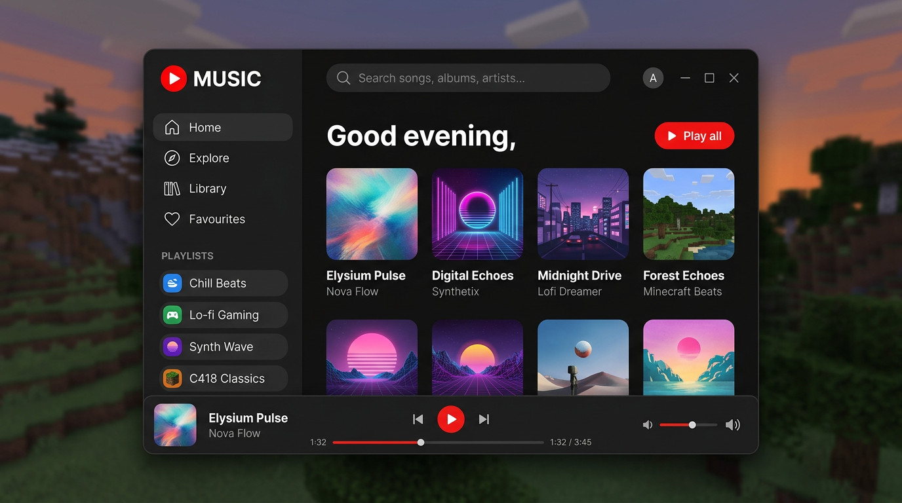

# MC Music — YouTube Music in Minecraft, rein clientseitig (Fabric 26.3)

Ein Musik-Client für **Minecraft Java 26.3 „Wilderness Bound"**, der wie eine moderne
Desktop-App aussieht: keine Pixel-Menüs, sondern ein hochauflösendes, abgerundetes
Interface mit Suche, Playlists, Favoriten und einem Player unten am Fenster — im Stil von
YouTube Music.

**Wichtig: der Mod läuft komplett auf deinem PC.** Suche, `yt-dlp`, `ffmpeg`, Dekodierung —
alles lokal. Die Musik wird anschließend in deinen **eigenen Simple-Voice-Chat-Mikrofonstream
gemischt**. Dadurch hören dich alle Spieler in Hörweite, die Simple Voice Chat installiert
haben. **Der Server braucht nur Simple Voice Chat — kein MC Music, keine Plugins, nichts.**

```
/mcmusic                 öffnet das GUI   (oder Taste M)
/mcmusic play <url|id>   spielt einen YouTube-Music-Link direkt ab
/mcmusic pause           Pause / Weiter
/mcmusic stop            stoppt die Wiedergabe
```

---



*Design-Konzept des GUIs (Mockup, keine Spielaufnahme) — genau diese Anordnung setzt
`MusicScreen` um: Sidebar mit Playlists, Suchleiste oben, Karten-Grid, Player-Leiste unten.*

---

## Wie das ohne Server-Mod funktioniert

Simple Voice Chat bietet für Client-Mods genau einen offiziellen Weg, Audio an andere
Spieler zu bringen: das Event **`MergeClientSoundEvent`**. Es wird auf dem Mikrofon-Thread
für jeden aufgenommenen 20-ms-Frame gefeuert und erlaubt Plugins, eigenes Audio
beizumischen:

```java
registration.registerEvent(MergeClientSoundEvent.class, event -> {
    short[] frame = ClientPlayer.get().nextVoiceFrame();  // 960 Samples, 48 kHz mono
    if (frame != null) event.mergeAudio(frame);
});
```

Was in diesem Frame landet, wird von Simple Voice Chat ganz normal encodiert und an den
Server geschickt — also genau wie deine Stimme. Daraus folgt:

* ✅ **Kein Server-Mod.** Der Server sieht nur einen Spieler, der spricht.
* ✅ **Andere brauchen nur Simple Voice Chat.** Kein Download, keine Freigabe, nichts.
* ✅ **Positional wie Stimme:** Andere hören die Musik „aus deiner Richtung", leiser mit
  Entfernung. In einer SVC-Gruppe hört dich die Gruppe (je nach Serverkonfiguration).
* ⚠️ **Reichweite = Sprachreichweite.** Wer weiter weg ist als die eingestellte
  `voice_chat_distance` (Standard 32 Blöcke), hört nichts. Das ist eine Eigenschaft von
  Voice Chat, nicht des Mods — genau wie bei Soundboard-Mods.
* ⚠️ **Du brauchst ein Mikrofon** (auch ein stummes/Dummy-Gerät genügt), weil SVC den
  Mikrofon-Thread nur dann laufen lässt. Ohne Mikrofon bleibt nur die lokale Wiedergabe.
* ⚠️ **Wer dich in SVC stummgeschaltet hat, hört auch die Musik nicht.** Ebenfalls wie
  bei Stimme.

Wer nur für sich hören will: in den Einstellungen `Voice Chat` auf `Off (local only)`
stellen — dann läuft die Musik ausschließlich über deine Lautsprecher.

---

## Inhalte

* **Modernes GUI** – eigene UI-Bibliothek mit runden Ecken, Blur-Hintergrund, Hover-Animationen,
  Scroll-Listen, Slidern und einer selbst gebackenen, kantengeglätteten Schrift (kein Vanilla-Pixel-Font).
* **Suche** über eine Piped- oder Invidious-Instanz (kostenlos, selbst hostbar, kein API-Key).
* **Favoriten** und **Playlists** – lokal gespeichert in `config/mcmusic-library.json`.
* **Queue, Shuffle, Repeat, Seek, Lautstärke** – alles lokal.
* **Zwei Themes** (Dark/Light), reduzierte Animationen als Option.

---

## Voraussetzungen

| Was | Version |
|---|---|
| Minecraft Java Edition | **26.3** |
| Fabric Loader | ≥ 0.19.3 |
| Fabric API | 0.160.5+26.3 oder neuer |
| Java | **25** (26.3 verlangt Java 25) |
| Simple Voice Chat | ≥ 2.4 (nur **dein** Client; Server: irgendeine SVC-Version, ohne Zusatzmods) |
| `yt-dlp` + `ffmpeg` | auf deinem PC, für echtes YouTube Music |

---

## Installation

1. `mcmusic-1.0.0.jar` nach `.minecraft/mods/` legen (zusammen mit Fabric API und
   Simple Voice Chat).
2. `yt-dlp` und `ffmpeg` installieren und in den `PATH` legen
   (`pip install yt-dlp`, `apt install ffmpeg` / `winget install Gyan.FFmpeg`).
3. Spiel starten, `M` drücken oder `/mcmusic` eingeben, suchen, abspielen.

Auf einem Server ohne Simple Voice Chat funktioniert das GUI und die lokale Wiedergabe,
aber niemand hört mit.

### Woher kommt das Audio?

`audioBackend` in `config/mcmusic.json`:

| Backend | Was passiert | Wann sinnvoll |
|---|---|---|
| `ytdlp` | `yt-dlp` holt den Stream, `ffmpeg` wandelt ihn live zu 48 kHz mono WAV | **echte YouTube-Music-Links** |
| `http` | Provider liefert eine direkte Audio-URL (mp3/wav) | eigene Quellen, kleine Setups |
| `local` | Dateien aus `mcmusic-library/<videoId>.mp3` | DJ-Sets, keine Internetabhängigkeit |
| `auto` (Default) | lokale Datei → `yt-dlp` → direkte URL | alles |

Für echtes YouTube Music ist `yt-dlp` + `ffmpeg` nötig, weil YouTube kein MP3/WAV ausliefert.
Beides läuft **nur auf deinem PC** und nur wenn `allowExternalTools: true` gesetzt ist.

> **Rechtliches:** MC Music lädt nichts herunter und hostet nichts. Es dekodiert einen Stream,
> den du selbst abrufst — wie ein Browser. Die YouTube-Nutzungsbedingungen können das dennoch
> einschränken; nutze am besten eigene/kreativlizenzierte Musik oder eine eigene
> Piped-/Invidious-Instanz.

---

## Bedienung

| Aktion | Wo |
|---|---|
| GUI öffnen | Taste `M` oder `/mcmusic` |
| Suchen | Suchfeld oben, `Enter` |
| Abspielen | Song-Zeile oder Karte anklicken |
| Pause / Weiter | Play-Button unten oder `Leertaste` |
| Nächster / Vorheriger | Buttons unten |
| Favorit | Herz-Symbol in der Zeile oder neben dem Player |
| Zu Playlist hinzufügen | Plus-Symbol erscheint beim Hovern einer Zeile |
| Playlist anlegen | Bibliothek → „New playlist" |
| Provider / Theme / Voice-Chat-Streaming / Lautstärke | Zahnrad unten links |
| Schließen | `Esc` oder X |

---

## Konfiguration

`config/mcmusic.json`:

```json
{
  "providerType": "piped",
  "pipedUrl": "https://pipedapi.kavin.rocks",
  "invidiousUrl": "https://inv.nadeko.net",
  "audioBackend": "auto",
  "allowExternalTools": true,
  "ytDlpPath": "yt-dlp",
  "ffmpegPath": "ffmpeg",
  "libraryFolder": "mcmusic-library",
  "volume": 0.65,
  "maxTrackSeconds": 900,
  "broadcastToVoicechat": true,
  "localPlayback": true,
  "darkTheme": true
}
```

* `broadcastToVoicechat` – Musik in den SVC-Mikrofonstream mischen (an/aus). Aus = nur du hörst.
* `localPlayback` – zusätzlich über die eigenen Lautsprecher ausgeben.
* `volume` – 0…1, wird vor dem Mischen angewandt.
* `providerType` – `piped` oder `invidious`. Öffentliche Instanzen wechseln häufig; wenn die
  Suche fehlschlägt, trage im GUI unter Einstellungen → Instance eine funktionierende URL ein.

Favoriten, Playlists und Verlauf liegen in `config/mcmusic-library.json`.

---

## Bauen

```bash
# JDK 25 oder neuer; der Wrapper holt sich Gradle 9.5.0 selbst
./gradlew build        # -> build/libs/mcmusic-1.0.0.jar
```

**Gradle-Version beachten:** Loom 1.17.x verlangt **Gradle 9.5 oder neuer**. Ein älteres
Gradle bricht schon beim Konfigurieren ab
(`No matching variant of net.fabricmc:fabric-loom:1.17.20 ... plugin.api-version 9.5.0`).
Der mitgelieferte Wrapper zeigt deshalb auf 9.5.0 — also bitte `./gradlew` benutzen statt
`gradle`, oder die eigene Installation aktualisieren (`gradle wrapper --gradle-version 9.5.0`).

In IntelliJ IDEA: Projekt öffnen, Gradle-Sync laufen lassen, `runClient`.

Die UI-Texturen (Font-Atlas, Icons, Ecken-Masken, Mod-Icon) sind **generiert**:

```bash
pip install pillow
python3 tools/gen_ui_assets.py
```

Damit werden `textures/gui/font.png`, `icons.png`, `corner*.png`, `shadow.png`,
`assets/mcmusic/icon.png` und die Metrik-Klasse `FontMetrics.java` neu erzeugt.

---

## Projektstruktur

```
src/main/java/de/chaostobimc/mcmusic/
├── MCMusic.java                  Konstanten (kein Server-Entrypoint!)
├── api/Track.java                Song-Datensatz
├── api/LocalPlaylist.java
├── config/MusicConfig.java       GSON-Config
├── provider/                     Piped- und Invidious-Anbindung (JSON/HTTP)
├── audio/                        PCM-Pipeline: yt-dlp/http/lokal, Decoder, Queue
├── voicechat/
│   ├── MCMusicVoicechatPlugin.java   MergeClientSoundEvent → Musik in den Mic-Stream
│   └── VoicechatSupport.java         Statusabfrage ohne SVC-Klassen zu laden
└── client/
    ├── MCMusicClient.java        Keybind, /mcmusic, Tick-Hook
    ├── ClientMusic.java          Queue, Bibliothek, Suche, Persistenz
    ├── NowPlaying.java           Snapshot für die UI
    ├── playback/ClientPlayer.java  Dekoder-Thread + Abspiel-Takt + Frame für SVC
    ├── playback/LocalSpeaker.java  Ausgabe auf die eigenen Lautsprecher
    └── ui/                       Theme, Font, Zeichen-Primitive, MusicScreen
```

**Signalweg:** Provider/`yt-dlp` → `AudioDecoder` (48 kHz mono, 16 bit) → `PcmQueue` (20 ms
Frames) → `ClientPlayer` schreibt jeden Frame auf die Soundkarte **und** legt ihn in
`liveFrame` → SVCs Mikrofon-Thread holt ihn über `MergeClientSoundEvent` ab, mischt ihn mit
deiner Stimme, encodiert ihn und schickt ihn an den Server → alle in Hörweite hören ihn.

---

## Bekannte Grenzen

* **Reichweite:** gehört wird, was in SVC-Sprachreichweite ist (oder in deiner Gruppe).
* **Kein Server-Mod** heißt auch: kein „Radio für den ganzen Server" mit einem Klick.
  Wer weiter weg steht, hört nichts — das ist bei SVC-Soundboards genauso.
* **Mikrofon nötig**, sonst läuft SVCs Mikrofon-Thread nicht.
* **Es gibt keine offizielle YouTube-Music-API für Wiedergabe.** Suche/Metadaten laufen über
  Piped/Invidious; das Audio kommt von `yt-dlp`/`ffmpeg` (lokal) oder aus einer direkten Quelle.
* Dieses Repository wurde in einer Umgebung ohne Zugriff auf die Fabric-/Mojang-Maven-Repos
  erstellt. Der Code ist gegen die echten 26.3-API-Signaturen (Mojang-Mappings, Fabric-API
  Branch 26.3, SVC-API inkl. `MergeClientSoundEvent`) geschrieben und syntaktisch geprüft,
  aber hier nicht kompiliert worden.

## Lizenz

MIT — siehe [LICENSE](LICENSE). Die gebackene Schrift basiert auf DejaVu Sans
(Bitstream Vera Lizenz, frei weiterverwendbar); die Icons sind generiert.
